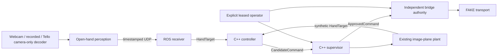

# Vision-guided Tello

Keep one eligible open hand near the image centre using lateral and vertical
translation. Laptop perception feeds the existing ROS 2 Jazzy C++ controller and
supervisor. Autonomous forward/backward and yaw stay zero. Distance remains manual.

The software includes a passive evidence monitor, loopback UDP/ROS tests, an
independently guarded **fake** command bridge, operator leases, frame sources,
and an explicitly invoked non-actuating SDK/video diagnostic. A separate,
supervised ROS path can send one bounded lateral trial through the Windows
gateway. It starts disabled and requires a local pilot arm and release. This
path has passed offline tests; physical ROS movement is not yet verified.



Choose the webcam chain or the mock in separate namespaces; the webcam is not a
feedback plant. New launch paths use fake transport; live camera scripts require deliberate
invocation. Importing transport/frame adapters opens no camera, socket or SDK session.

Build and test on WSL Ubuntu 24.04 / ROS 2 Jazzy:

```bash
cd ~/vision_guided_tello_ws
tools/run_offline_checks.sh
source /opt/ros/jazzy/setup.bash
source install/local_setup.bash
python3 tools/offline_demo.py --scenario static --output /tmp/tello-demo-baseline
python3 tools/offline_demo.py --scenario loss --output /tmp/tello-demo-loss
```

Each demo requires a new output directory and writes synthetic reports/logs.
It explicitly enables the software mock and fake bridge for a bounded session;
ordinary launches require a separate operator enable.

The enabled FAKE target-loss repeat, grounded real-SDK transport bench, and
propellers-removed Stage D movement bench have passed. The pilot has reported
app-only takeoff, hover, landing, and the onboard no-command landing response.
The supervised first ROS lateral pulse remains a separate physical stage.
Follow the [first lateral trial procedure](docs/first_lateral_trial.md) and
[staged commissioning runbook](docs/commissioning_runbook.md). The
[readiness audit](docs/readiness_2026-10-13.md) maps requirements to code/tests and
lists the remaining physical-mode design and hardware blockers. Per-axis limits
and a 60-second development session cap are configurable; defaults are not flight tuned.
The [movement-gateway design gate](docs/movement_gateway_offline_design.md)
defines the separate grounded-bench and flight processes.
See [Windows/WSL setup](docs/windows_wsl_setup.md), [authority and interfaces](docs/architecture.md),
[offline validation](docs/offline_validation.md), [current checkpoint](docs/current_checkpoint.md)
and [dependency/model provenance](docs/provenance.md).
The earlier [image-plane model record](docs/point3_image_plane_mock.md) remains relevant.
